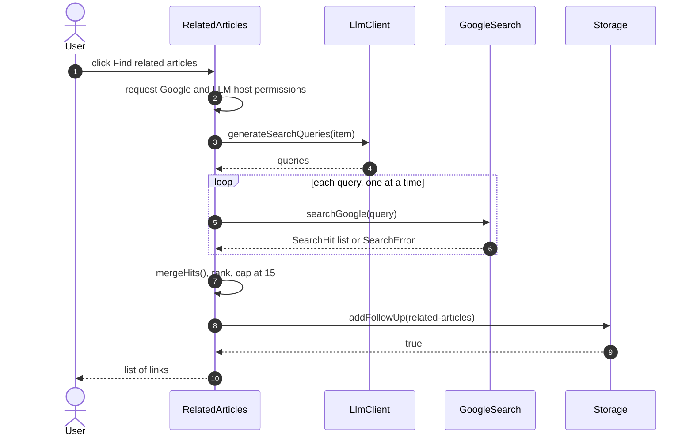

# Find Related Articles

## Summary

- The reader view of a saved item gets the button "Find related articles".
- The button sends the item to the configured LLM. The LLM writes 3 to 5 Google search queries.
- The extension runs each query on Google with the cookies of the user's Chrome profile. It needs no API key.
- The extension saves the result links on the item as a follow-up.
- This story stores links only. Fetching the linked articles is Phase II and out of scope.

The main design decision is the search transport (D1). An extension page calls `fetch` with `credentials: 'include'` and parses the HTML with `DOMParser`.

## Context and Gap

| Existing | State today | Change |
| --- | --- | --- |
| `src/shared/types.ts` `FollowUpType` | `'llm-summary' \| 'user-question'` | Add `'related-articles'`; add `RelatedArticle` type |
| `src/shared/importExport.ts` `parseFollowUp` | Rejects unknown follow-up types; requires `generatedContent` string | Accept `related-articles`; validate `articles` |
| `src/llm/client.ts` `LlmClient` | `complete()` sends one message; `src/followups/tagging/generateTags.ts` shows the pattern for JSON answers | Add `src/followups/related/generateSearchQueries.ts` that calls `LlmClient.complete()` |
| `src/followups/` pipelines | `summary/`, `questions/`, `tagging/` implement `FollowUpPipeline`; `services.ts` wires them to storage | Add `related/RelatedArticlesPipeline.ts` and wire it in `services.ts` |
| `src/shared/storage.ts` | `addFollowUp`, `updateFollowUp`, `deleteFollowUp` serialize writes | Reuse without change |
| `src/app/dashboard/panels/registry.tsx` | Lists the reader panels `Summary`, `Questions`, `VideoDetails` | Add the `RelatedArticles` panel after `Questions` |
| `src/llm/permission.ts`, `panels/common/useLlmGate.ts` | Request the LLM host permission inside the click handler | Add `extraOrigins`, so one prompt asks for the LLM host and `https://www.google.com/*` |
| `public/manifest.json` | `optional_host_permissions` is `http://*/*` and `https://*/*` | Add the `https://www.google.com/*` host as a requested permission at click time; no manifest change if the broad optional pattern already covers it |

> Context: the optional host permissions cover the LLM server today. `requestLlmPermission` in `src/llm/permission.ts` shows the call shape. The follow-up storage model is in `src/shared/types.ts`. The story was written before commit `51a5b04` ("major refactoring") moved the code to `src/llm`, `src/followups` and `src/app/dashboard/panels`; the tables in this story use the paths after that commit.

## Design Decisions

### D1: The extension fetches Google result pages with the user's cookies, from an extension page

- **Decision:** `searchGoogle()` calls `fetch('https://www.google.com/search?q=<query>&hl=en&udm=14', { credentials: 'include' })` from the dashboard page and parses the HTML with `DOMParser`.
- **Reason:** the extension needs no API key and no extra tab. Measured on 2026-11-25 in the user's Chrome: a same-origin `fetch` with cookies returned a full result page (9 to 10 links with `a:has(h3)`). The same URL fetched with `curl` and a Chrome user agent, without cookies, returned a stub that asks for JavaScript (`/httpservice/retry/enablejs`). The parameter `udm=14` selects the "Web" filter. It removed the AI overview and returned exactly 10 organic results. The `num` parameter had no effect (9 results with and without `num=20`).
- **Rejected:** the official Custom Search JSON API - needs an API key and a search engine ID, and the user ruled out API keys. It wins if Google blocks cookie-based scraping.
- **Rejected:** a hidden incognito window - incognito has none of the user's cookies, so Google serves the cookie consent page and a stricter bot check. Incognito also requires the user to enable "Allow in Incognito" for the extension.
- **Rejected:** DuckDuckGo `html.duckduckgo.com/html` as the primary engine - the user asked for Google. A `curl` test returned the "anomaly" bot-check page. See D5.
- **Revisit if:** Google serves the JavaScript stub or `/sorry/` pages to extension `fetch` calls (see Assumption A1). Then switch to D2.

> Clarification: a second measurement on 2026-11-25, with the result page fetched by `fetch` inside a `google.com` tab, found that a full result page also contains the string `/httpservice/retry/enablejs` (in a `<noscript>` part). `searchGoogle()` therefore treats a page as the JavaScript stub only when it has 0 results and contains that string.

> Assumption: A1. The measurement above ran `fetch` inside a `google.com` tab, so it sent same-origin headers (`Sec-Fetch-Site: same-origin`). A `fetch` from `chrome-extension://<id>` sends `Origin: chrome-extension://...` and `Sec-Fetch-Site: cross-site` or `none`, and Google may treat it differently. Verify in Phase 1: write `searchGoogle()` first, run it from the dashboard page, and count the parsed results. The spike result decides between D1 and D2.

> Assumption: A2. With a host permission, Chrome attaches the user's cookies to extension `fetch` calls, including `SameSite=Lax` cookies. Verify in the same Phase 1 spike by comparing results with and without `credentials: 'include'` while the user is signed in to Google.

### D2: Fallback transport - a background tab that renders the result page

- **Decision:** if A1 fails, `searchGoogle()` opens `chrome.tabs.create({ url, active: false })` in the normal profile, waits for `status: 'complete'`, runs `chrome.scripting.executeScript` to read `a:has(h3)` links, and closes the tab. This flow needs only the `scripting` permission and the Google host permission. The manifest has the first, and the click handler requests the second.
- **Reason:** a real tab runs Google's JavaScript, so it never receives the `enablejs` stub. It carries the full cookie jar and all browser headers.
- **Rejected:** an offscreen document with an iframe - Google sends `X-Frame-Options: SAMEORIGIN`, so the iframe needs a `declarativeNetRequest` rule that strips the header. That weakens a security control for one feature.
- **Revisit if:** Chrome shows tab flicker that the user dislikes. Use `chrome.windows.create({ state: 'minimized' })`.

### D3: The LLM writes the queries; keyword extraction is the fallback

- **Decision:** `generateSearchQueries()` sends the title, channel, description, and transcript to the configured LLM with `QUERY_PROMPT`. The answer is a JSON array of 3 to 5 strings. `parseQueries()` reads it like `parseTags()`. If no LLM is reachable, the button builds 2 queries from the title and the top AI or keyword tags.
- **Reason:** a transcript is long and spoken. A title alone misses sub-topics. The project already has an LLM client and a prompt-permission flow. The queries stay on the user's machine until they reach Google.
- **Rejected:** one query from the title - finds only the video itself and its reposts.
- **Rejected:** sending the whole transcript to Google - Google cuts queries at 32 words, and the transcript would leak private text.

> Rationale: the prompt tells the LLM to write queries that find articles, not videos. It adds `-site:youtube.com` to each query in code, not in the prompt, so a model cannot forget it.

### D4: Results are stored as a new follow-up type, `related-articles`

- **Decision:** the result is one `FollowUp` with `type: 'related-articles'` and a new optional field `articles: RelatedArticle[]`. `generatedContent` holds the Markdown list of the same links.
- **Reason:** follow-ups already have storage, import/export, delete, and rendering slots. A separate store key would need new import and export code.
- **Rejected:** a new field on `SavedItem` - a second place to merge on import. A follow-up carries `createdAt` and `model`, which the result needs anyway.
- **Rejected:** `generatedContent` only - Phase II needs structured URLs and a per-article fetch state.

> Rationale: `generatedContent` stays a required string, because `parseFollowUp` requires it and older exports lack the new field. The Markdown copy makes the existing Markdown export work without change.

### D5: Google is the only search engine

- **Decision:** `searchGoogle()` is the only search function. The story adds no engine setting and no second parser.
- **Reason:** the user chose Google only. It keeps the scope to one parser and one set of rate rules.
- **Rejected:** DuckDuckGo as a fallback - needs a second parser and its own bot-check handling. A cookie-less `curl` test returned the "anomaly" page, and the result with cookies is unmeasured.
- **Revisit if:** Google blocks the user often (more than 1 cooldown per day of use). Add a `SearchEngine` interface with `search(query): Promise<SearchHit[]>` then.

> Rationale: a Google block leaves the button disabled until the 10-minute cooldown ends. The user accepted this.

### D6: The block appears for every item type

- **Decision:** the reader renders `RelatedArticles` for `youtube_transcript` and `webpage_text` items.
- **Reason:** the code does not depend on the item type. `PromptItem` already carries both types, and `Questions` already switches its wording by type.
- **Rejected:** a block for `youtube_transcript` only - adds a type check and hides a working feature for page items.

> Rationale: `QUERY_PROMPT` says "transcript or page text" and omits the `-site:youtube.com` exclusion only when the item URL is not on `youtube.com`. For page items, the item host is excluded in the result list (see Search rules), so the source page does not appear as a related article.

## Technical Breakdown

### Data model

```typescript
type FollowUpType = 'llm-summary' | 'user-question' | 'related-articles';

interface RelatedArticle {
  url: string; // canonical result URL, without Google tracking parameters
  title: string; // text of the result heading
  snippet?: string; // result description, when the page has one
  queries: string[]; // the queries that returned this URL, in order of rank
  bestRank: number; // best 1-based rank over all queries
  fetchState?: 'pending' | 'done' | 'failed'; // reserved for Phase II; Phase I leaves it unset
}

interface FollowUp {
  // existing members unchanged
  articles?: RelatedArticle[]; // only for type 'related-articles'
  queries?: string[]; // the queries that were run, for type 'related-articles'
}
```

### Behavioral diagram

The sequence below shows one click on "Find related articles".



### Components

| Component | File | Responsibility |
| --- | --- | --- |
| `RelatedArticles` | `src/app/dashboard/panels/related/RelatedArticles.tsx` | Block with the button, progress, error text, cooldown, and the saved list |
| `useRelatedArticles` | `src/app/dashboard/panels/related/useRelatedArticles.ts` | Requests the permissions, runs the pipeline, holds progress, error, and cooldown |
| `readCooldown`, `startCooldown` | `src/app/dashboard/panels/related/cooldown.ts` | Keeps the 10-minute cooldown in `localStorage` |
| `RelatedArticlesPipeline` | `src/followups/related/RelatedArticlesPipeline.ts` | Queries, spaced searches, `mergeHits()`, `addFollowUp()` |
| `generateSearchQueries` | `src/followups/related/generateSearchQueries.ts` | Builds the message with `QUERY_PROMPT`, calls `LlmClient.complete()`, returns `parseQueries()` output |
| `QUERY_PROMPT`, `buildQueryMessage` | `src/followups/related/prompt.ts` | The prompt text and the message with title, channel, description, and text |
| `parseQueries` | `src/followups/related/parseQueries.ts` | Reads a JSON array or lines; trims, deduplicates, drops queries over 20 words |
| `buildFallbackQueries` | `src/followups/related/fallbackQueries.ts` | Builds queries from title and tags without an LLM |
| `searchGoogle` | `src/shared/googleSearch.ts` | Fetches one result page and returns `SearchHit[]` (D1) |
| `parseGoogleResults` | `src/shared/googleSearch.ts` | Pure function: HTML string to `SearchHit[]`. Unit-tested with saved HTML |
| `mergeHits` | `src/shared/googleSearch.ts` | Deduplicates by normalized URL, sorts by number of queries, then rank |

> Rationale: the pipeline and the query code are a follow-up module in `src/followups/related/`, like `summary/` and `tagging/`, because `.dependency-cruiser.cjs` keeps follow-up modules independent and the LLM transport free of follow-up code. `buildFallbackQueries` is in that module instead of `src/shared/relatedQueries.ts` for the same reason. `searchGoogle` stays in `src/shared/` because it is a framework-free transport that a later phase can reuse.

> Clarification: when Google blocks a query after earlier queries returned results, the pipeline stops, saves the results found so far, and the panel starts the cooldown. When nothing was found, the pipeline saves nothing and the panel shows the error with the queries. The cooldown is in `localStorage`, so it holds for every item and survives a reload; losing it only allows an earlier retry.

### Search rules

| Rule | Value |
| --- | --- |
| URL | `https://www.google.com/search?q=<query> -site:youtube.com&hl=en&udm=14&pws=0` |
| Queries per click | 3 to 5, from the LLM; 2 from the fallback |
| Request spacing | 1 request at a time, with 1.5 to 3 seconds of random delay between requests |
| Result selector | `a:has(h3)` inside `#search` or `#rso`; fall back to any `a[href^="http"]` that contains an `h3` |
| URL cleaning | Unwrap `/url?q=` links; remove `utm_*`, `srsltid`, and `#` fragments; strip a trailing `/` |
| Excluded hosts | `google.*`, `youtube.com`, `youtu.be`, and the host of the item URL |
| Cap | 15 articles per follow-up |
| Abort conditions | Redirect to `/sorry/` or `consent.google.com`, HTTP 429, the `enablejs` stub, or 0 results on all queries |
| Cooldown after an abort | The button is disabled for 10 minutes. The block shows the reason. |

> Rationale: `pws=0` turns off personalized results so the same query gives repeatable links. The user's cookies still let Google trust the request. `-site:youtube.com` keeps the list free of the source video and other videos. The spacing and the cooldown keep the request rate below the level that triggers the Google bot check. The numbers are a guess (A3).

> Assumption: A3. The delay of 1.5 to 3 seconds and the limit of 5 queries per click avoid the `/sorry/` page. No test measured this. Verify by running 10 clicks in a row during Phase 1 and counting `/sorry/` redirects.

> Assumption: A4. The `a:has(h3)` selector matches Google's current markup. Google changes class names often but has kept `h3` inside result links for years. The Phase 1 test fixture `google-serp.html` pins the markup that was measured on 2026-11-25: result blocks are `#rso > div.MjjYud`, the link is `a.zReHs` with a direct `https://` href around the `h3`, and the snippet is `div.VwiC3b` with a `span.YrbPuc` date prefix and an optional `a.vzmbzf` "Read more" link. The fixture keeps that nesting and those class names; the browser tool that read the page blocks output with query strings, so the fixture was rebuilt from the measured block markup and the 10 measured results, without tracking parameters. When Google changes the markup, update the fixture and the selector together.

> Risk: scraping Google violates its terms of service and can lead to a CAPTCHA for the user's IP and account session. The feature runs only on a user click, with a small number of requests. The cooldown limits the harm. If the CAPTCHA appears often, switch to D2. D5 rules out a second engine for this story.

### Query prompt

`QUERY_PROMPT` asks for 3 to 5 Google queries that find articles about the claims and topics of the transcript. The prompt has these rules:

- Each query has 3 to 10 words.
- Queries cover different sub-topics, not paraphrases of one topic.
- Queries use names, terms, and numbers from the transcript. They do not contain the channel name.
- The answer is a JSON array of strings only.

> Rationale: the existing `TAG_PROMPT` uses the same "JSON array only" rule and `parseTags()` already survives code fences and stray text. `parseQueries()` follows that approach.

### User interface

- **Block:** "Related articles" in the reader, below `Questions`, built with `ContentBlock` (`storageKey="related"`).
- **Button:** "Find related articles", violet outline like `AiTagsButton`. While it works, it shows a loader and the step: "Writing queries…", "Searching 2 of 4…".
- **Result:** a list of links. Each row shows the title, the host, and the queries that found it. A link opens in a new tab with `rel="noreferrer"`.
- **Repeat:** a second click adds a new follow-up and keeps the old one. Each follow-up has a delete action and shows its date and queries.
- **Error:** an `Alert` states the cause and keeps the queries so the user can see what ran.

## Out of Scope

- Fetching, reading, or summarizing the linked articles (Phase II).
- Search engines other than Google (D5).

## Limitations

- Google can show the bot check at any time. The feature then shows the reason and pauses for 10 minutes.
- Google result markup can change without notice. A markup change returns 0 results and shows an error.
- The Google request carries the user's cookies and the query text. The query text can reveal what the user watches. The Privacy section of `README.md` must state that.

## Verification

| Check     | Command                                                   |
| --------- | --------------------------------------------------------- |
| Typecheck | `npm run typecheck`                                       |
| Build     | `npm run build`                                           |
| Lint      | `npm run lint`                                            |
| Test      | `npm test`                                                |
| Format    | `npm run format:check`                                    |
| Cycles    | `npm run depcruise`                                       |
| Start     | `npm run dev`, then load `dist/` in `chrome://extensions` |

The project has no E2E setup, so this story has no E2E phase.

## Measurements

| Assumption | Result on 2026-11-25 |
| --- | --- |
| A1 (extension-origin `fetch` gets the full page) | Not measured. The browser tool cannot open `chrome-extension://` pages. |
| A2 (cookies attached to extension `fetch`) | Not measured, same cause as A1. |
| A3 (10 spaced queries cause no `/sorry/`) | Not measured, same cause as A1. |
| A4 (`a:has(h3)` matches) | Confirmed in a `google.com` tab: 10 results, all with direct hrefs, all inside `#rso`. |

> Todo: run the snippet below in the DevTools console of the dashboard page (`dashboard.html` of the dev build) after one click on "Find related articles" granted the Google permission. Record `withCookies` (A1), `withoutCookies` (A2), and `sorry` (A3) in the table above. If `withCookies` is below 8 or shows the stub, implement D2.

```js
const run = async (q, credentials) => {
  const r = await fetch(`https://www.google.com/search?${new URLSearchParams({ q, hl: 'en', udm: '14', pws: '0' })}`, {
    credentials,
  });
  const html = await r.text();
  const doc = new DOMParser().parseFromString(html, 'text/html');
  const hits = [...doc.querySelectorAll('#search a[href]')].filter((a) => a.querySelector('h3')).length;
  return { status: r.status, sorry: r.url.includes('/sorry/'), hits };
};
const withCookies = await run('sleep deprivation memory study', 'include');
const withoutCookies = await run('sleep deprivation memory study', 'omit');
const sorry = [];
for (const q of [
  'rem sleep learning',
  'caffeine memory study',
  'hippocampus sleep replay',
  'insomnia cognition',
  'nap memory consolidation',
  'sleep spindles memory',
  'all-nighter exam performance',
  'sleep and emotional memory',
  'melatonin memory',
  'sleep deprivation attention',
]) {
  await new Promise((done) => setTimeout(done, 1500 + Math.random() * 1500));
  sorry.push((await run(q, 'include')).sorry);
}
console.log({ withCookies, withoutCookies, sorry: sorry.filter(Boolean).length });
```

## Tasks

**Phase 1: Search spike and parser (settles A1, A2, A3, A4):**

- [x] Ensure project compiles and existing tests are passing
- [x] Add `src/shared/googleSearch.ts` with `searchGoogle()`, `parseGoogleResults()`, and `mergeHits()` (D1)
- [x] Save one real result page as `src/shared/__tests__/fixtures/google-serp.html` and test the parser against it
- [ ] Run `searchGoogle()` from the dashboard page with the extension loaded; record the result of A1 and A2 in this story. If A1 fails, implement D2 and record why. (see `## Measurements`)
- [ ] Run 10 queries in a row and record the number of `/sorry/` redirects (A3) (see `## Measurements`)
- [x] Add tests for the code of this phase

Acceptance criteria:

- [x] `npm test` passes, including `parseGoogleResults extracts 10 links from the fixture`
- [x] `npm test` passes, including `mergeHits deduplicates by normalized URL and orders by query count`
- [ ] Manual: `searchGoogle('sleep deprivation memory study')` from the dashboard console returns at least 8 hits
- [ ] The story states the measured results of A1 to A3

**Phase 2: Queries and storage:**

- [x] Add `'related-articles'`, `RelatedArticle`, `articles`, and `queries` to `src/shared/types.ts` (D4)
- [x] Update `parseFollowUp` in `src/shared/importExport.ts` to accept and validate the new type
- [x] Add `QUERY_PROMPT`, `parseQueries()`, and `generateSearchQueries()` to `src/shared/llm.ts` (D3)
- [x] Add `buildFallbackQueries()` in `src/shared/relatedQueries.ts`
- [x] Render a `related-articles` follow-up as Markdown in the Markdown export
- [x] Add tests for the code of this phase

Acceptance criteria:

- [x] `npm test` passes, including `parseQueries reads a JSON array inside a code fence`
- [x] `npm test` passes, including `import accepts a related-articles follow-up and rejects an invalid articles list`
- [x] `npm test` passes, including `export then import keeps related articles`
- [x] `npm run typecheck` and `npm run depcruise` pass

**Phase 3: Button and block:**

- [x] Add `src/app/dashboard/panels/related/RelatedArticles.tsx` with the button, progress, error, list, and delete action
- [x] Request the Google host permission inside the click handler, before any `await`
- [x] Add the cooldown after an abort condition
- [x] Render the block below `Questions` (`panels/registry.tsx`; `ItemReader.tsx` renders the registered panels)
- [x] Add tests for the code of this phase, for a video item and for a page item (D6)

Acceptance criteria:

- [x] `npm test` passes, including `RelatedArticles renders for a webpage_text item`
- [x] `npm test` passes, including `RelatedArticles saves a follow-up after a successful search`
- [x] `npm test` passes, including `RelatedArticles shows the cooldown after a /sorry/ response`
- [ ] Manual: click the button on a saved video with the dev build; links appear and survive a page reload

**Phase X:**

- [x] Update `README.md`: feature list, permissions, and the privacy statement about Google requests
- [x] Update `docs/todo.md` with the Phase II task "fetch related articles"
- [x] Review the implementation against this story and the project conventions

Acceptance criteria:

- [ ] Every command in `## Verification` passes
- [x] The application starts with the Start command
